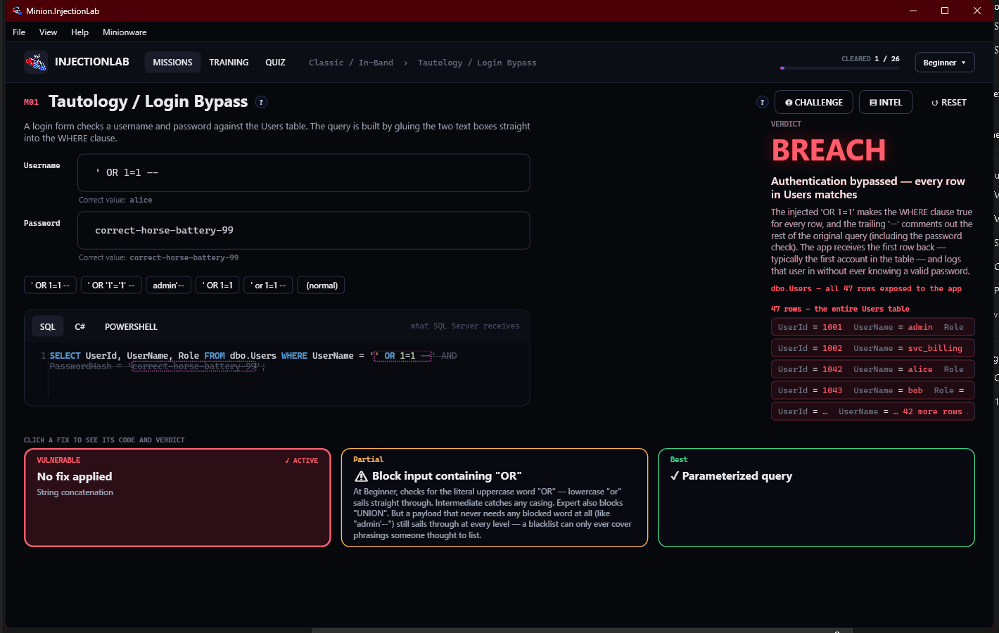
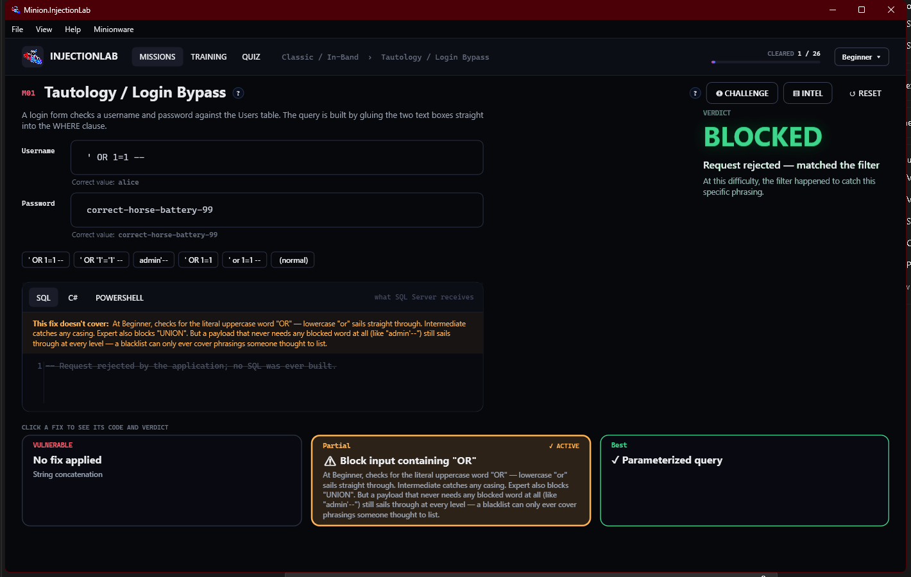
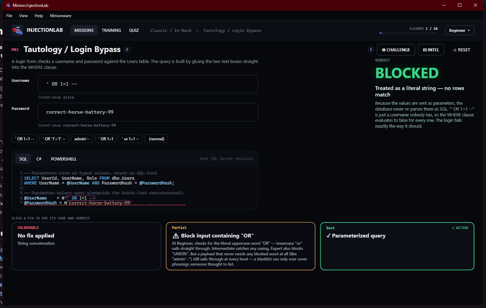

# Watching the Fix Change the Code

Every mission has three tiles at the bottom: **Vulnerable**, **Partial**, and **Best**. They
aren't a status readout — they're tabs. **Click one and the SQL/C#/PowerShell panel above it,
and the VERDICT panel on the right, both switch to show what *that* version of the code actually
does with your input.** That's the whole point of the screen: the bug isn't abstract, it's one
specific line of code, and you can watch it change as you click between the three.

## Vulnerable — the code that causes it

Click **Vulnerable** and the code panel shows exactly how the app built its SQL: by gluing your
input straight into a string. That concatenation is the entire vulnerability — there's no
special "bug," just a query built the way a huge number of real apps build one.

Here's Tautology / Login Bypass with `' OR 1=1 --` typed into Username — the code above shows
the input landing inside the quotes, and the verdict shows the result: the database re-parses
your input as part of the query, the WHERE clause becomes unconditionally true, and the login
succeeds as the first row in the table.

## Partial — a real mitigation, with a real gap

Click **Partial** and the code panel changes again — same input, different app logic. This fix
is a keyword filter: it rejects the request *in the application*, before any SQL is even built
(notice the code above literally becomes a one-line rejection comment, not a query). It's a real
mitigation teams genuinely ship, not a straw man — and the panel on the left spells out exactly
what it still misses, in plain English, with a sample payload that proves it.

## Best — parameterized, and why that's different

Click **Best** and look closely at the code panel: your input isn't inside the query text
anymore at all. It's sent *alongside* the query as a separate, labeled value (`@UserName`,
`@PasswordHash`), and the query itself never changes shape no matter what you type. That's the
mechanical reason the verdict changes from "breach" to "treated as a literal string" — there's no
SQL text left for the database to re-parse.

## The takeaway

Same input, three different outcomes — because the only thing that changed between them is the
code above, not the payload. That's the one idea behind every fix in this app: it was never about
detecting bad input, it was about whether the input is ever treated as code in the first place.
See **[Feature List](overview.md)** for the rest of the tour, or jump into the
**[Attack Catalog](../catalog/overview.md)** to try this on a mission yourself.
